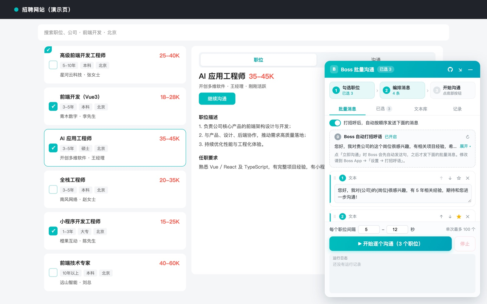
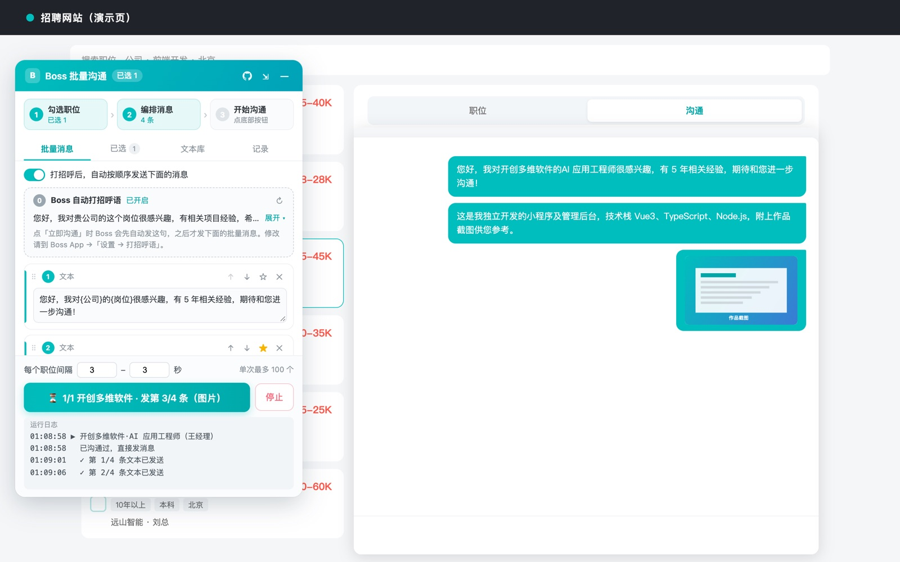
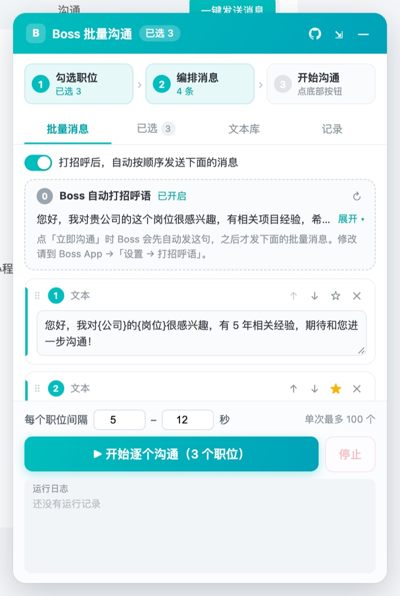
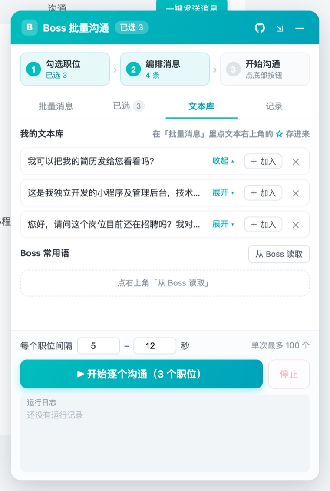
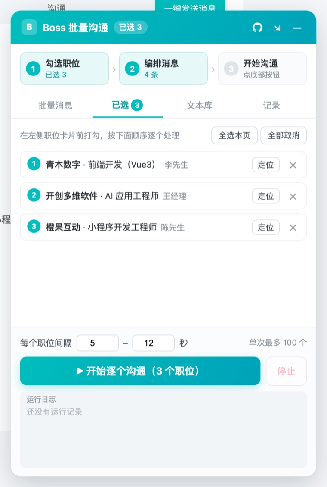
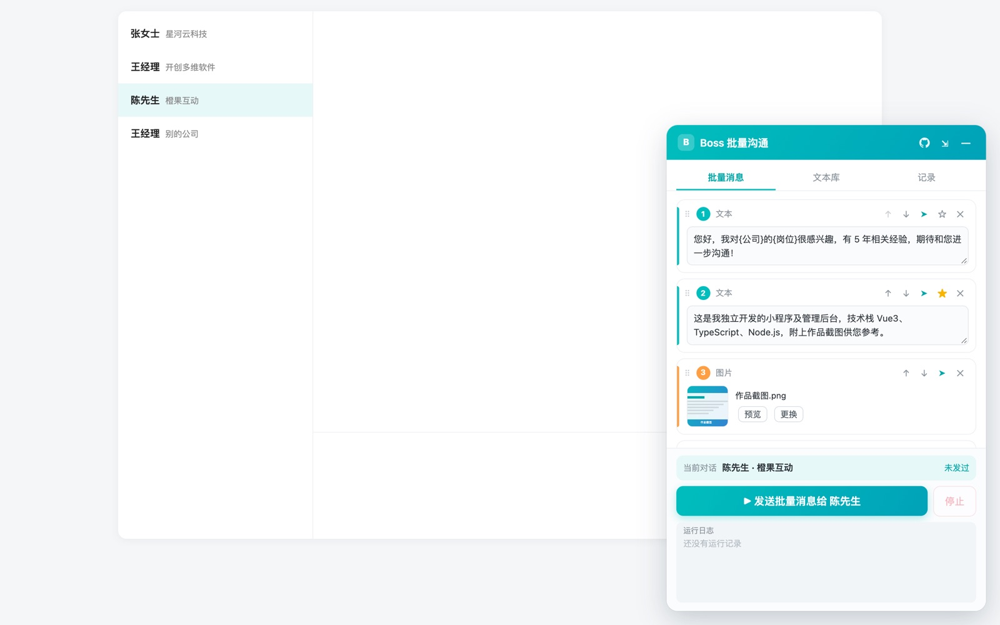

# Boss 批量沟通 · 自己挑职位，一键打招呼 + 按顺序发消息

<p>
  <a href="https://github.com/xiaoxing1617/boss-batch-chat/stargazers"></a>
  
  
  <a href="LICENSE"></a>
</p>

> ⭐ **如果这个小工具帮你省了时间，请点一下右上角的 Star 支持一下！** 你的每一个 Star 都是我继续更新的动力，也能让更多正在找工作的人发现它。也可以[请作者喝杯咖啡 ☕](#支持作者)，或者[加入交流群 💬](#交流群)。

一个简单的浏览器扩展：在 Boss 直聘的职位列表里，**你自己勾选**想沟通的职位，点一下按钮，它会**一个一个**帮你点「立即沟通」，然后按你编排好的顺序发送多条**文本 + 图片**消息。上一条确认发送成功才发下一条，绝不发错人、不重复发。

不用装 Java、Python，也不会另开浏览器，直接在你平时登录好的 Chrome / Edge 里用。

<p align="center">
  
</p>

<sub>截图里是演示页面和演示数据，不是真实的公司和 HR。</sub>

## 为什么做这个

市面上的“自动投递”工具大多是全自动海投：不管合不合适，按关键词一路打招呼。这样很容易被 HR 当成群发，也容易被平台限制。

这个工具反过来：**挑谁由你决定**，它只负责把重复的体力活做掉——打招呼、把自我介绍、作品截图、约面试的话按顺序发出去。

## 功能

### 职位列表页

- **左侧勾选**：每张职位卡片左边多一个勾选框，不挡薪资；刷新页面后勾选自动清空，不会带上看不见的旧勾选。
- **「已选」列表**：面板里列出所有勾选的职位，可以单个取消、定位到卡片、或者全部取消。
- **逐个完成**：一个职位处理完（打招呼 → 发完全部消息）才处理下一个。没沟通过的先点「立即沟通」，已沟通过的直接发消息。
- **职位 / 沟通 两个 tab**：右侧详情上方多了两个 tab，「沟通」里直接嵌入 Boss 聊天页，自动滚到最右边，能实时看到消息发出去。
- **实时播报**：运行时开始按钮变成进度条，比如「⏳ 2/5 新诺电子 · 发第 3/4 条（图片）」「完成 ✓，8 秒后下一个」。
- **完成标记**：发过消息的职位卡片左上角会出现 ✓；只发出一部分的显示橙色 !。

<p align="center">
  
</p>

### 批量消息

- **文本、图片任意组合**，长按一行拖动排序（也可以点 ↑ ↓）。
- **严格按顺序**：上一条确认发送成功才发下一条；任何一条失败，立即停止给这个人发。
- **变量**：`{公司}` `{岗位}` `{HR}` `{薪资}`，点标签插入到光标位置，发送时自动替换。
- **图片**：点缩略图或「预览」看大图，「更换」直接换一张，顺序不变。
- **Boss 打招呼语**：最上面的「0」号是你在 Boss 设置的自动打招呼语（Boss 自己发，这里只读显示）。
- **收藏**：点文本右上角的 ☆ 存进文本库，★ 表示已收藏，再点一下移出。

<p align="center">
  
  &nbsp;
  
  &nbsp;
  
</p>

### 文本库

- 「我的文本库」：常用的话存一次，以后点「＋ 加入」就回到批量消息并加在最后。
- 「Boss 常用语」：一键读取你在 Boss 里设置的常用语。
- 长文本默认只显示一行，点「展开 ▾ / 收起 ▴」看完整内容。

### 聊天页（/web/geek/chat）

直接打开 Boss 聊天页时，面板会切换成「聊天模式」：

- 底部显示**当前对话**是谁、有没有发过批量消息。
- 「▶ 发送批量消息给 TA」：给当前对话的人按顺序发（同样防重复，每条都核对是不是这个人）。
- 每条消息右上角的 ➤：**只发这一条**给当前对话。
- 文本库里的「插入」：放进 Boss 输入框但不发送，改完自己发。
- 「移除记录」：删掉这个人的发送记录，之后可以再发一次。

<p align="center">
  
</p>

### 面板

- 可拖动；右上角的 GitHub 图标打开本项目，⇲ 回到右下角默认位置，— 收起成一条小胶囊：

<p align="center">
  
</p>

### 关于 / 检查更新

- 面板的「关于」页显示当前版本、GitHub 仓库地址、反馈问题和交流群入口。
- 面板会自动检查 GitHub 上有没有新版本（6 小时检查一次），有新版本时「关于」旁边出现小红点。
- **一键更新**：点「一键更新」会打开更新页，自动下载新版本、写入扩展文件夹并重新加载，打开着的 Boss 页面也会自动刷新。详见下面的[更新](#更新)。

## 不会发错人、不会重复发

这是这个工具最在意的事：

- **找会话**：HR 名字**完全一致** + 公司名一致，并且只有**唯一一个**匹配才发；没找到或者有多个同名，直接跳过，绝不猜。
- **每条消息发送前**都再核对一次当前打开的会话是不是这个人，不是就清空输入框并停止。
- **发送记录**：给某个 HR（名字 + 公司）发出过消息就会记下来，之后不会再发；同时还会检查聊天记录里是否已经有第一条文本。
- **宁可漏发，不重复发**：如果某条消息等了很久没确认成功，也会记入发送记录，不会再补发一遍。
- **变量读不到就不发**：比如聊天页拿不到 `{薪资}`，整组消息都不发，避免发出“我对的职位很感兴趣”这种缺字的话。
- 想重新发给某个人：在「记录」页清空记录，或在聊天页点「移除记录」。

## 系统要求

| 项目 | 要求 |
| --- | --- |
| 浏览器 | Chrome 111 或更新，或 Microsoft Edge 111 或更新（Windows / macOS 都可以） |
| 账号 | 在这个浏览器里登录 Boss 直聘网页版（求职者身份） |
| 页面 | 职位搜索页 `zhipin.com/web/geek/jobs`，或聊天页 `zhipin.com/web/geek/chat` |

## 安装

这个扩展没有上架应用商店，用「开发者模式」加载，一共 4 步：

1. **下载代码**：在本页面点绿色的 **Code → Download ZIP**，然后解压；或者用 git：

   ```bash
   git clone https://github.com/xiaoxing1617/boss-batch-chat.git
   ```

2. **打开扩展页**：Chrome 地址栏输入 `chrome://extensions`（Edge 输入 `edge://extensions`）。
3. **打开右上角「开发者模式」**。
4. **点「加载已解压的扩展程序」**，选择解压后的文件夹（里面直接能看到 `manifest.json` 的那一层）。

装好后打开 Boss 直聘的职位搜索页，右下角就会出现面板。

### 更新

**方法一：一键更新（推荐）**

1. 有新版本时，面板「关于」页会显示「发现新版本」，点 **一键更新到 vX.Y.Z**。
2. 在打开的更新页里再点一次 **一键更新**。
3. **只有第一次**：浏览器会让你选择一个文件夹，选当初「加载已解压的扩展程序」时选的那个（里面直接有 `manifest.json`），然后点「允许修改」。之后再更新就不用选了（浏览器重启后可能会再问一次是否允许）。
4. 更新页会自动：从 GitHub 下载新版本 → 解压 → 写入文件 → 重新加载扩展 → 刷新打开着的 Boss 页面。

> 为什么要选文件夹？浏览器不允许扩展自己改自己的文件，没上架商店的扩展只能这样更新。更新页只会写入扩展自己的文件（`manifest.json`、`src/`、`docs/` 等），不会动文件夹以外的任何东西，也不会删除你的文件。

**方法二：手动更新**

到 [Releases](https://github.com/xiaoxing1617/boss-batch-chat/releases/latest) 下载最新的 Source code (zip)，解压后覆盖原来的文件夹，到 `chrome://extensions` 在扩展卡片上点刷新 ↻，再刷新 Boss 页面。用 git clone 安装的，在文件夹里运行 `git pull` 再点刷新 ↻ 也可以。

## 使用

1. 在浏览器里正常登录 Boss 直聘，打开职位搜索页 `https://www.zhipin.com/web/geek/jobs`。
2. 在右下角面板的「批量消息」里编排要发的内容：`＋ 文本消息` / `＋ 图片` / `从文本库选`，长按拖动调整顺序。
3. 在职位卡片左边勾选想沟通的职位。
4. 点「▶ 开始逐个沟通」，看按钮上的实时播报和底部日志；随时可以点「停止」。

> 💡 **建议第一次只勾 1~2 个职位试一下**，确认效果再批量用。

没登录时，面板顶部会出现「还没登录 Boss 直聘」的提示条，开始按钮显示「请先登录」；消息可以先编排好。

## 注意

- Boss 每天打招呼有上限（大约 150 次），本工具单次最多处理 100 个；职位之间默认随机等待 5~12 秒，可以自己调。
- 遇到跳转登录页、安全验证、打招呼达到上限，会立即停止并在日志里说明原因。
- **自动化操作违反 Boss 直聘的用户协议，有被限制或封号的风险，请适量使用，后果自行承担。**
- Boss 不允许打开开发者工具（会自动关闭页面）。如果 Boss 改版导致失效，请在面板「记录 → 诊断」里采集页面结构，附在 [Issue](https://github.com/xiaoxing1617/boss-batch-chat/issues) 里。

## 隐私

**所有数据只保存在你自己的浏览器里，不上传到任何地方，也没有任何统计或服务器。**

| 数据 | 存在哪里 |
| --- | --- |
| 批量消息、文本库、发送记录、面板位置 | `zhipin.com` 的 localStorage |
| 图片 | `zhipin.com` 的 IndexedDB |

扩展只在 `zhipin.com/web/geek/*` 页面运行，会访问的地址只有：

| 用途 | 地址 | 发送的内容 |
| --- | --- | --- |
| 读取登录状态、你的打招呼语 | Boss 直聘自己的接口（zhipin.com） | 无（浏览器自带你的登录信息） |
| 检查新版本 | api.github.com（本项目的发布信息，6 小时一次） | 无 |
| 一键更新时下载新版本 | api.github.com / codeload.github.com | 无 |

卸载扩展、或者清除 zhipin.com 的网站数据，就全部删除了。

## 支持作者

这个项目完全免费、开源，是我利用业余时间做的。如果它帮你省了时间、你也愿意支持一下，可以用支付宝或微信扫码请我喝杯咖啡 ☕。金额随意，**完全自愿**，不打赏也能正常使用全部功能；点一个 ⭐ Star 同样是很大的鼓励。

<p align="center">
  
</p>

## 交流群

扫码加我微信，**备注来意**，我拉你进群 👇

<p align="center">
  
</p>

| 群 | 适合谁 |
| --- | --- |
| 🛠 **技术交流群** | 聊浏览器扩展、前端、自动化脚本；反馈 bug、提新功能，第一时间收到更新通知 |
| 🚀 **大佬交流群** | 独立开发、开源、副业、出海，和做产品的大佬们交流经验、对接资源 |
| 📚 **学习交流群** | 求职面试、简历优化、学习路线、资料互助，找工作路上互相打气 |

加好友时请**备注来意**，比如：

- `Boss 批量沟通 + 技术群`
- `GitHub + 大佬群`
- `求职 + 学习群`

> 没有备注的好友申请可能会被忽略；群里禁止广告和刷屏，进群后改一下群昵称（城市 + 方向，比如「北京 · 前端」）方便大家认识。

## 项目结构

```text
boss-batch-chat/
├── manifest.json      扩展配置（Manifest V3）
├── src/
│   ├── main.js        面板和全部发送逻辑：勾选、发送、防重复（运行在 Boss 页面里）
│   ├── panel.css      面板和页面上的样式
│   ├── bridge.js      页面和扩展后台之间传话（检查更新用）
│   ├── background.js  扩展后台：检查 GitHub 新版本、更新后刷新页面
│   └── update.*       一键更新页面
└── docs/              README 用的截图和图片
```

## 更新日志

- **v0.5.0**：新增「关于」页（版本、GitHub 仓库、反馈、交流群）；自动检查 GitHub 新版本，支持一键更新；去掉职位详情里的「一键发送消息」按钮（统一用「开始逐个沟通」）。
- **v0.4.0**：聊天页模式（发给当前对话、单条发送、插入输入框、移除记录）；运行时实时播报；职位卡片完成标记；图片预览 / 更换；收藏星标区分；未登录提示和异常处理；面板 GitHub 图标、一键回到右下角、收起成小胶囊。
- **v0.3**：批量消息长按拖动排序；面板高度固定；文本库；读取 Boss 打招呼语；展开 / 收起长文本。
- **v0.2**：职位 / 沟通双 tab；多条文本 + 图片按顺序发送；防发错人、防重复；已选列表。
- **v0.1**：第一个版本。

## 开源协议

[MIT](LICENSE)：可以免费使用、修改、商用和再发布，只需保留版权声明。

## 声明

本项目是个人开源项目，与 Boss 直聘（北京华品博睿网络技术有限公司）没有任何关联。仅供学习和个人求职使用，请遵守平台规则，适量使用。
