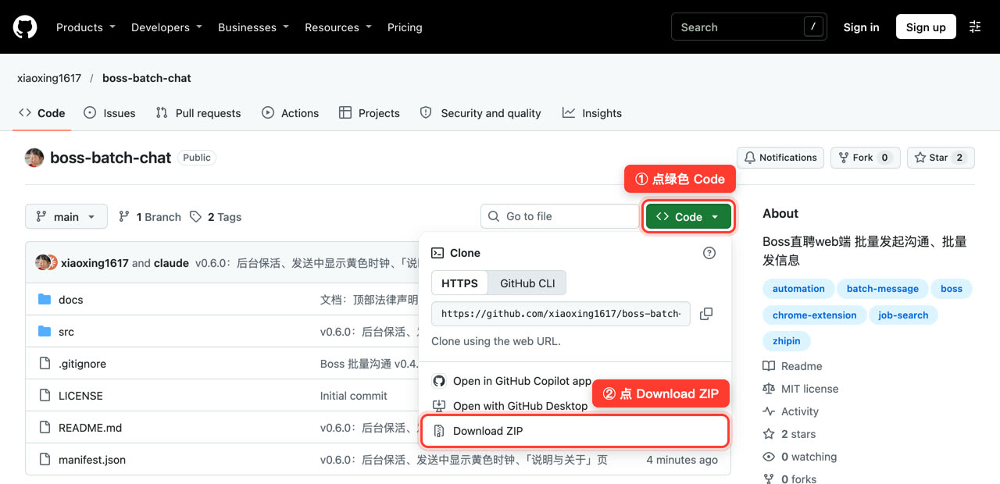
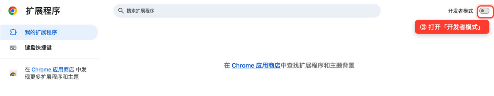
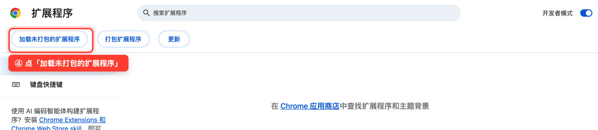
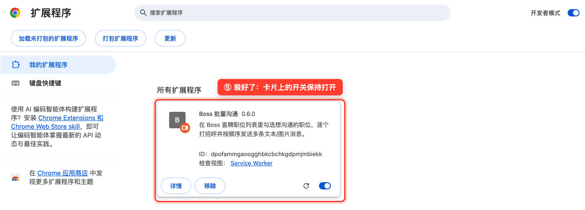
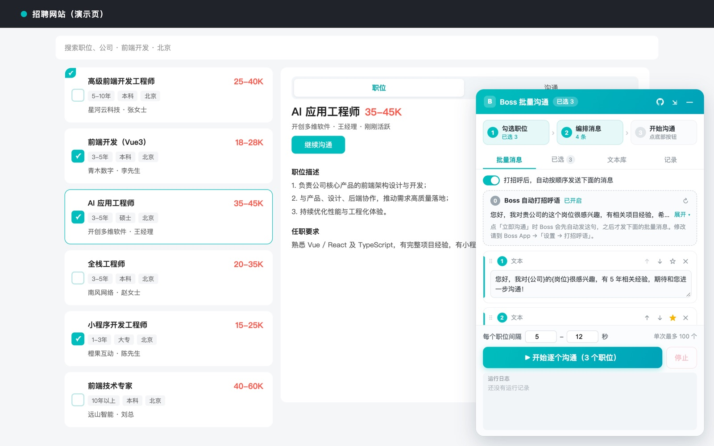

# 📦 Boss 批量沟通 · 详细安装教程（Chrome / Edge）

> 这个扩展没有上架应用商店，需要用浏览器自带的「开发者模式」加载，**全程大约 2 分钟**，不用装任何软件。
>
> 不想自己动手？直接跳到 [🤖 一句话让 AI 帮你安装](#-一句话让-ai-帮你安装)。

**目录**

- [安装前准备](#安装前准备)
- [第一步：下载并解压（Chrome、Edge 通用）](#第一步下载并解压chromeedge-通用)
- [Chrome 安装步骤](#chrome-安装步骤)
- [Edge 安装步骤](#edge-安装步骤)
- [装好之后怎么用](#装好之后怎么用)
- [🤖 一句话让 AI 帮你安装](#-一句话让-ai-帮你安装)
- [常见问题](#常见问题)

---

## 安装前准备

| 需要 | 说明 |
| --- | --- |
| 浏览器 | **Google Chrome 111+** 或 **Microsoft Edge 111+**，Windows、macOS 都可以。地址栏输入 `chrome://settings/help`（Edge 输入 `edge://settings/help`）可以看版本号 |
| 账号 | 在**同一个浏览器**里登录 Boss 直聘网页版（求职者身份） |
| 一个固定的文件夹 | 扩展装好后，浏览器每次都从这个文件夹读取代码，**之后不能删也不能挪**。建议放在「文档 / Documents」里，**不要放在「下载」或桌面上随手清理的地方** |

---

## 第一步：下载并解压（Chrome、Edge 通用）

1. 打开项目主页：<https://github.com/xiaoxing1617/boss-batch-chat>
2. **① 点绿色的 `Code` 按钮 → ② 点 `Download ZIP`**，会下载一个 `boss-batch-chat-main.zip`。

<p align="center"></p>

> 也可以到 [Releases 页面](https://github.com/xiaoxing1617/boss-batch-chat/releases/latest) 下载最新版本的 `Source code (zip)`，内容一样。
> 会用 git 的话：`git clone https://github.com/xiaoxing1617/boss-batch-chat.git`

3. **解压**：Windows 右键 → 「全部解压缩」；macOS 双击 zip 即可。
4. 把解压出来的文件夹**移动到一个固定位置**，例如「文档」里。
5. **确认文件夹层级对不对**（最容易出错的地方）：打开文件夹，**一眼就能看到 `manifest.json`** 才是对的那一层。

```text
✅ 正确：选这一层
boss-batch-chat-main/
├── manifest.json      ← 直接能看到它
├── src/
├── docs/
└── README.md

❌ 不对：外面多套了一层（Windows 解压时常见）
boss-batch-chat-main/
└── boss-batch-chat-main/   ← 要选的是里面这一层
    ├── manifest.json
    └── ...
```

---

## Chrome 安装步骤

### ③ 打开扩展页，打开「开发者模式」

在 Chrome 地址栏输入下面这行，回车：

```text
chrome://extensions
```

> 也可以点右上角 **⋮ → 扩展程序 → 管理扩展程序**。

打开页面**右上角**的 **「开发者模式」** 开关。

<p align="center"></p>

### ④ 点「加载未打包的扩展程序」

开发者模式打开后，左上角会多出一排按钮，点 **「加载未打包的扩展程序」**（老版本 Chrome 叫「加载已解压的扩展程序」）。

<p align="center"></p>

在弹出的窗口里，**选中第一步里那个能直接看到 `manifest.json` 的文件夹**，点「选择」（macOS 是「打开」/「选择」）。

> 注意：是**选文件夹**，不用点进去选某个文件。

### ⑤ 看到卡片就装好了

扩展列表里出现 **「Boss 批量沟通」** 卡片，右下角开关是**蓝色（打开）**，就安装成功了。

<p align="center"></p>

> 可选：点浏览器右上角的拼图图标 🧩，把「Boss 批量沟通」旁边的📌点亮，固定到工具栏（不固定也完全不影响使用，面板会直接出现在 Boss 页面上）。

---

## Edge 安装步骤

Edge 和 Chrome 是同一个内核，步骤几乎一样，**只是按钮的位置和名字略有不同**：

| 步骤 | Chrome | Edge |
| --- | --- | --- |
| 打开扩展页 | 地址栏输入 `chrome://extensions` | 地址栏输入 `edge://extensions` |
| 菜单入口 | ⋮ → 扩展程序 → 管理扩展程序 | ··· → 扩展 → 管理扩展 |
| 开发者模式开关 | 页面**右上角**「开发者模式」 | 页面**左侧栏底部**「开发人员模式」 |
| 加载按钮 | 「加载未打包的扩展程序」 | 「加载解压缩的扩展」 |

具体操作：

1. **下载并解压**：和上面的[第一步](#第一步下载并解压chromeedge-通用)完全一样。
2. 在 Edge 地址栏输入下面这行，回车：

   ```text
   edge://extensions
   ```

3. 在页面**左侧栏最下面**，打开 **「开发人员模式」** 开关。
   （窗口比较窄、看不到左侧栏时，点左上角的 ☰ 菜单展开。）
4. 页面上方会出现几个按钮，点 **「加载解压缩的扩展」**。
5. 选中**能直接看到 `manifest.json` 的那个文件夹**，点「选择文件夹」。
6. 列表里出现 **「Boss 批量沟通」**，开关是打开的，就装好了。

> Edge 有时会在启动时提示「关闭开发人员模式扩展」，**点「保留」或直接关掉提示**就行，不要点「关闭扩展」。

---

## 装好之后怎么用

1. 打开 Boss 直聘职位搜索页：<https://www.zhipin.com/web/geek/jobs>（已经开着的话**刷新一下**）。
2. 页面**右下角**会出现「Boss 批量沟通」面板，每张职位卡片左边多了一个勾选框。
3. 勾选职位 → 在面板里编排消息 → 点「开始逐个沟通」。详细用法见 [README 的「使用」部分](../README.md#使用)。

<p align="center"></p>

> 💡 发送时建议把 Boss 标签页**拖出来单独成一个窗口**；切到别的标签页也能继续跑（插件做了后台保活），说明见面板「说明与关于」页。

**以后怎么更新？** 不用重装。有新版本时，在面板「说明与关于」页点「一键更新」就行，详见 [README 的「更新」部分](../README.md#更新)。

---

## 🤖 一句话让 AI 帮你安装

如果你在用能操作电脑的 AI 助手（例如 Claude Code、Cursor、Codex、Trae、豆包电脑版等，能帮你运行命令或操作浏览器的那种），**把下面这一段整段复制发给它**：

```text
请帮我安装这个浏览器扩展：https://github.com/xiaoxing1617/boss-batch-chat
严格按照仓库里 docs/INSTALL.md 的「给 AI 的安装步骤」来做：把代码下载并解压到我的「文档」文件夹里（以后不要删），确认 manifest.json 所在的那一层文件夹，然后帮我打开浏览器的扩展页面，告诉我还需要我自己点哪几下。我用的浏览器是：Chrome（或 Edge）。
```

> 出于安全原因，Chrome / Edge 不允许程序自动「加载未打包的扩展」，**最后「打开开发者模式 + 选择文件夹」这两下一般要你自己点**（能直接操作屏幕的 AI 也可以替你点）。AI 会把文件夹准备好、把路径告诉你，你照着点就行。

### 给 AI 的安装步骤

> 这一节是写给 AI 助手看的，普通用户可以跳过。

1. **确定安装位置**：用户「文档」目录下的 `boss-batch-chat`。
   - macOS / Linux：`~/Documents/boss-batch-chat`
   - Windows：`%USERPROFILE%\Documents\boss-batch-chat`
   - 如果目录已经存在且里面有 `manifest.json`（`"name": "Boss 批量沟通"`），说明装过了：提示用户在面板「说明与关于」页一键更新，或在扩展页点刷新 ↻，**不要覆盖用户的文件**。
2. **下载代码**（任选一种）：
   - 有 git：`git clone https://github.com/xiaoxing1617/boss-batch-chat.git <安装位置>`
   - 没有 git：下载 `https://github.com/xiaoxing1617/boss-batch-chat/archive/refs/heads/main.zip` 解压，把里面的 `boss-batch-chat-main` 文件夹改名为 `boss-batch-chat` 并移动到安装位置。
     - macOS：`curl -L -o /tmp/bbc.zip <上面的地址> && unzip -q /tmp/bbc.zip -d /tmp/bbc && mv /tmp/bbc/boss-batch-chat-main ~/Documents/boss-batch-chat`
     - Windows PowerShell：`Invoke-WebRequest <上面的地址> -OutFile $env:TEMP\bbc.zip; Expand-Archive $env:TEMP\bbc.zip $env:TEMP\bbc -Force; Move-Item $env:TEMP\bbc\boss-batch-chat-main "$env:USERPROFILE\Documents\boss-batch-chat"`
3. **校验**：安装位置下直接存在 `manifest.json`，并且 `name` 是 `Boss 批量沟通`。
4. **加载扩展**：新版 Chrome / Edge 已不支持用命令行参数 `--load-extension` 加载扩展，所以：
   - 打开 `chrome://extensions`（Edge 为 `edge://extensions`）；
   - 让用户打开「开发者模式 / 开发人员模式」，点「加载未打包的扩展程序 / 加载解压缩的扩展」，选择第 1 步的安装位置（把完整路径发给用户，方便复制）；
   - 如果你能操作用户的屏幕，也可以代为点击，但不要改动浏览器的其他设置。
5. **验证**：扩展列表里出现「Boss 批量沟通」且已启用；打开 `https://www.zhipin.com/web/geek/jobs`，右下角出现面板即成功。
6. **不要**：不要上传、读取或修改用户的浏览器数据、Cookie、账号信息；不要安装其他扩展；不要改系统设置。

---

## 常见问题

**Q：选文件夹时提示「清单文件缺失或不可读取」？**
A：选错层级了。请选**直接能看到 `manifest.json`** 的那一层文件夹，见[第一步的第 5 点](#第一步下载并解压chromeedge-通用)。

**Q：装好了，但 Boss 页面右下角没有面板？**
A：
1. 确认扩展卡片的开关是打开的；
2. 刷新一下 Boss 页面（装扩展之前就打开的页面需要刷新）；
3. 确认打开的是职位搜索页 `zhipin.com/web/geek/jobs` 或聊天页 `zhipin.com/web/geek/chat`；
4. 浏览器版本太旧（低于 111）的话，请先升级浏览器。

**Q：扩展卡片上出现红色「错误」按钮？**
A：一般是文件不完整，重新下载解压一遍，然后在扩展页点卡片上的刷新 ↻。还不行的话，点「错误」把内容截图，到 [Issues](https://github.com/xiaoxing1617/boss-batch-chat/issues) 反馈。

**Q：把文件夹删了 / 挪了，扩展不见了？**
A：开发者模式加载的扩展依赖这个文件夹。放回原位置，或者在扩展页「移除」后按上面的步骤重新加载新位置。

**Q：每次打开浏览器都提示「关闭开发者模式扩展」？**
A：这是浏览器对所有非商店扩展的统一提醒，点「保留」或关掉提示就行，不影响使用。

**Q：安装安全吗？**
A：代码全部开源，可以自己查看。扩展只在 Boss 直聘的求职者页面运行，只连 GitHub 检查新版本，不收集、不上传任何个人数据，详见 [README 的「隐私」部分](../README.md#隐私)。使用前请务必阅读 [法律声明与版权声明](../README.md#法律声明与版权声明)。
